::: {custom-style="IRSTI"}
IRSTI 20.19; 28.23
:::

::: {custom-style="Article Title"}
How chunk size and overlap affect retrieval quality in retrieval-augmented generation: an experiment on SQuAD
:::

::: {custom-style="Author Line"}
A. Kulush
:::

::: {custom-style="Affiliation"}
International Information Technology University, Almaty, Kazakhstan\
e-mail: ____________________
:::

::: {custom-style="Abstract Text"}
**Abstract.** Retrieval-augmented generation (RAG) systems split documents into chunks before indexing them, and the way the text is split directly limits what the retriever can find. This study measures how chunk size, overlap between neighbouring chunks and paragraph-based chunking affect BM25 retrieval. Nine strategies were compared on SQuAD v1.1: 490 Wikipedia articles (2.46 million words) and 10,570 questions with marked answers. A 25% overlap raised Hit@5 for every size, by 0.5–6.8 percentage points, and removed answers cut by chunk boundaries (McNemar test with Holm correction, p < 0.05). At a fixed number of chunks, larger chunks scored higher (400 words: Hit@5 = 0.878). Under an equal context budget of 400 words, however, small overlapping chunks (0.836) and paragraphs (0.835) clearly beat 400-word chunks (0.681). Paragraph chunking gave the best Hit@1 (0.707) and MRR@10 (0.779). The results support a simple default: 100-word overlapping chunks or paragraphs, with k chosen from the context budget.
:::

::: {custom-style="Abstract Text"}
**Keywords:** retrieval-augmented generation, chunking, chunk size, overlap, BM25, SQuAD.
:::

::: {custom-style="Abstract Text"}
**Аннотация.** В системах генерации, дополненной поиском (RAG), документы перед индексацией делятся на фрагменты (чанки), и способ деления напрямую ограничивает то, что может найти поисковый модуль. В работе измерено, как размер фрагмента, перекрытие соседних фрагментов и деление по абзацам влияют на качество поиска BM25. Девять стратегий сравнивались на наборе SQuAD v1.1: 490 статей Википедии (2,46 млн слов) и 10 570 вопросов с размеченными ответами. Перекрытие 25% повысило Hit@5 для всех размеров на 0,5–6,8 процентного пункта и устранило разрезание ответов границами фрагментов (критерий Макнемара с поправкой Холма, p < 0,05). При фиксированном числе фрагментов выше были крупные фрагменты (400 слов: Hit@5 = 0,878), однако при равном бюджете контекста 400 слов малые фрагменты с перекрытием (0,836) и абзацы (0,835) заметно превзошли фрагменты по 400 слов (0,681). Деление по абзацам дало лучшие Hit@1 (0,707) и MRR@10 (0,779). Результаты обосновывают простое правило: фрагменты по 100 слов с перекрытием или абзацы и выбор k по бюджету контекста.
:::

::: {custom-style="Abstract Text"}
**Ключевые слова:** генерация, дополненная поиском, разбиение текста, размер фрагмента, перекрытие, BM25, SQuAD.
:::

::: {custom-style="Abstract Text"}
**Аңдатпа.** Іздеумен толықтырылған генерация (RAG) жүйелерінде құжаттар индекстелмес бұрын бөліктерге (чанктарға) бөлінеді, ал бөлу тәсілі іздеу модулінің не таба алатынын тікелей шектейді. Бұл жұмыста бөлік өлшемі, көрші бөліктердің қабаттасуы және абзац бойынша бөлу BM25 іздеуінің сапасына қалай әсер ететіні өлшенді. Тоғыз стратегия SQuAD v1.1 жинағында салыстырылды: Википедияның 490 мақаласы (2,46 млн сөз) және жауаптары белгіленген 10 570 сұрақ. 25% қабаттасу барлық өлшемдерде Hit@5 көрсеткішін 0,5–6,8 пайыздық тармаққа арттырды және жауаптардың бөлік шекарасымен кесілуін жойды (Холм түзетуімен Макнемар критерийі, p < 0,05). Бөліктер саны тұрақты болғанда үлкен бөліктер жоғары нәтиже көрсетті (400 сөз: Hit@5 = 0,878), алайда 400 сөздік бірдей контекст бюджетінде қабаттасқан шағын бөліктер (0,836) мен абзацтар (0,835) 400 сөздік бөліктерден (0,681) айтарлықтай озды. Абзац бойынша бөлу ең жоғары Hit@1 (0,707) және MRR@10 (0,779) мәндерін берді. Нәтижелер қарапайым ережені негіздейді: қабаттасуы бар 100 сөздік бөліктер немесе абзацтар және k санын контекст бюджеті бойынша таңдау.
:::

::: {custom-style="Abstract Text"}
**Түйін сөздер:** іздеумен толықтырылған генерация, мәтінді бөлу, бөлік өлшемі, қабаттасу, BM25, SQuAD.
:::

# Introduction

Large language models (LLMs) answer fluently, but they do not know an organisation's private documents and may invent facts. Retrieval-augmented generation (RAG) addresses this problem: before answering, the system retrieves passages from an external collection and gives them to the model as context [@lewis2020]. Since 2020 RAG has become the standard way to connect LLMs to company knowledge bases, and recent surveys describe it as a pipeline of indexing, retrieval and generation [@gao2023; @fan2024]. In this pipeline, indexing comes first, and its first step is chunking — cutting each document into pieces that are stored and retrieved as units.

Chunking looks like a technical detail; nevertheless, it decides three things at once. First, it decides what a "document" is for the retriever: a ranking function such as BM25 scores whole chunks [@robertson2009; @manning2008], so the same words score differently in a short and in a long chunk. Second, it decides whether an answer survives indexing at all: if a boundary falls inside the sentence that contains the answer, no single chunk holds it. Third, it decides the cost of the context: every retrieved chunk is copied into the prompt, and LLM serving cost grows with prompt length [@kwon2023], while models use information in the middle of long contexts less reliably [@liu2024lost].

Previous research has approached this question from several directions. Dense passage retrieval fixed the passage at 100 words, a convention that later systems copied [@karpukhin2020]. Chen et al. showed that the unit of retrieval matters and that fine-grained "propositions" can beat passages under the same budget [@chen2024densex]. Qu et al. compared semantic and fixed-size chunking and found that the extra cost of semantic chunking was not justified by consistent gains [@qu2024semantic]. In contrast, RAPTOR builds a tree of summaries over chunks to answer questions that need the whole document [@sarthi2024raptor]. Evaluation frameworks such as RAGAs measure the quality of the retrieved context and of the final answer [@es2024]. Table 1 summarises these works.

Table: Table 1 – Prior work on the unit of retrieval in RAG

| Work | Unit of retrieval | Main finding relevant to chunking |
|:----------------------|:------------------------|:----------------------------------|
| Karpukhin et al., 2020 [@karpukhin2020] | Fixed 100-word passages | Became the de facto passage size for open-domain QA |
| Lewis et al., 2020 [@lewis2020] | 100-word Wikipedia passages | Defined RAG: retriever + generator over passages |
| Chen et al., 2024 [@chen2024densex] | Documents, passages, sentences, propositions | Finer units improve retrieval under a fixed word budget |
| Qu et al., 2024 [@qu2024semantic] | Fixed-size vs semantic chunks | Semantic chunking costs more without consistent gains |
| Sarthi et al., 2024 [@sarthi2024raptor] | Tree of chunks and summaries | Multi-level units help questions over long documents |

Table 1 shows, however, that most studies use dense neural retrievers and report one configuration per method. Consequently, practitioners still lack a simple, fully reproducible measurement of the basic knobs that every RAG framework exposes: chunk size, overlap and paragraph boundaries, compared both at a fixed k and at a fixed context budget. Moreover, the effect of overlap is rarely tested statistically.

Therefore, the aim of this study is to measure how chunk size, overlap and structure-aware chunking affect retrieval quality and context cost in a RAG pipeline. The object of the study is the indexing stage of a RAG system; the subject is the dependence of retrieval quality on the chunking strategy. Three hypotheses are tested:

- H1: a 25% overlap increases Hit@5 compared with the same chunk size without overlap;
- H2: at a fixed number of retrieved chunks, larger chunks give a higher Hit@k, but at an equal context budget smaller chunks are better;
- H3: chunking by paragraphs performs at least as well as fixed windows of similar size.

In summary, chunking is an unavoidable design decision in RAG whose effect on a classical retriever has not been measured systematically. The next section describes the data, strategies and metrics used to test the three hypotheses.

# Materials and methods

**Data.** The experiment uses SQuAD v1.1, a reading-comprehension dataset of questions written by crowd workers on Wikipedia paragraphs, where every answer is a span of the paragraph [@rajpurkar2016]. SQuAD was chosen for two reasons: the answer positions are marked exactly, so relevance can be checked automatically, and the dataset is open and widely used. To turn it into a retrieval task, every article of the training and development sets (442 + 48 = 490 articles, 20,963 paragraphs, 2,457,629 words) became one document, with its paragraphs joined by blank lines. The 10,570 development questions served as queries. Thus, each question must be found in a corpus of all 490 articles, not only in its own paragraph.

**Chunking strategies.** Nine strategies were compared. Fixed-N cuts a document into windows of N words (N = 50, 100, 200, 400) with step N; "+25% overlap" uses a step of 0.75N, so neighbouring windows share a quarter of their words (12, 25, 50 and 100 words). Paragraph chunking keeps each original paragraph as one chunk (117 words on average). Figure 1 shows the whole evaluation procedure for one strategy.

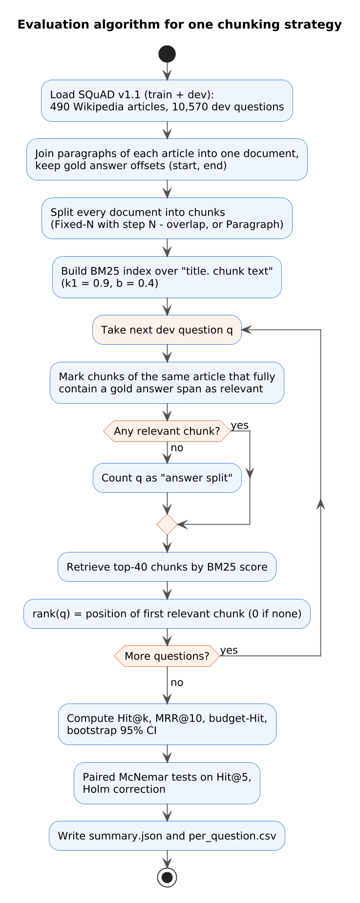{width=5.8cm}

**Relevance and metrics.** A chunk is relevant to a question if it belongs to the same article and fully contains at least one gold answer span. If no chunk contains the answer, the question is counted as an "answer split" — the boundary has cut the answer. For each question the retriever returns 40 chunks; the rank of the first relevant chunk gives Hit@k (k = 1, 3, 5, 10, 20), the share of questions with a relevant chunk in the top k, and MRR@10, the mean reciprocal rank [@manning2008]. Because chunk sizes differ, a fixed k is unfair to small chunks; therefore, a budget metric was also computed: for a budget of B words (100–1600), k = ⌊B / mean chunk size⌋ chunks are given to the model, and the hit within this k is measured.

**Retriever.** All strategies use the same Okapi BM25 ranking function [@robertson2009] with k1 = 0.9 and b = 0.4, lower-cased word tokens and the article title prepended to each chunk. BM25 was chosen deliberately: it has no training and no random seed, so differences between runs are caused by chunking alone. The code was written in Python with NumPy, SciPy and scikit-learn sparse matrices. Figure 2 shows its structure, and Figures 3–5 show the key fragments.

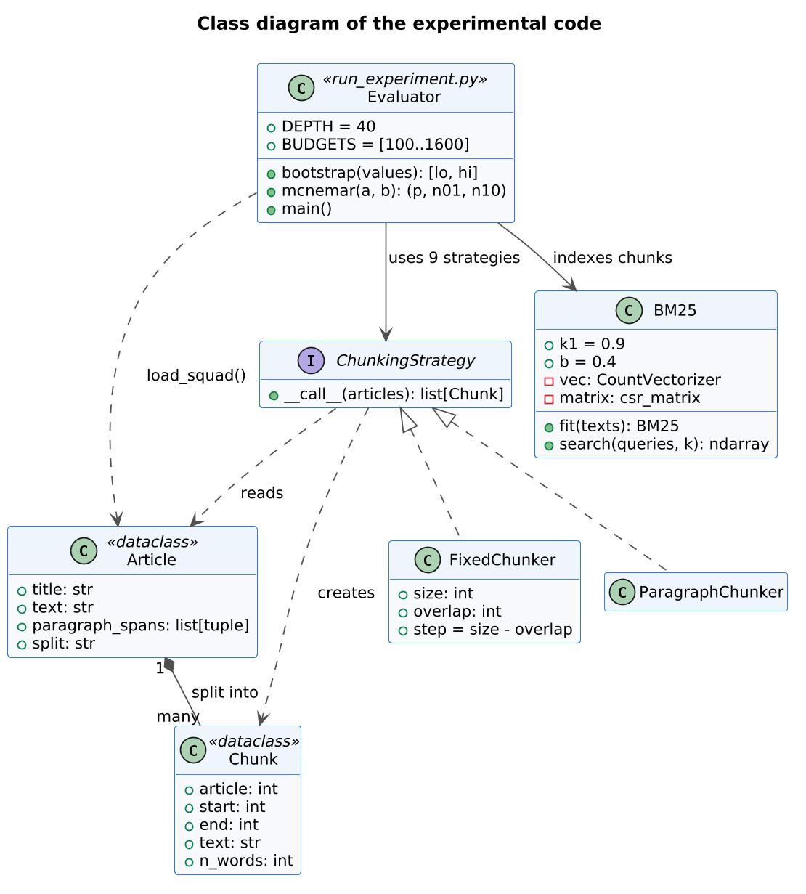{width=9.5cm}

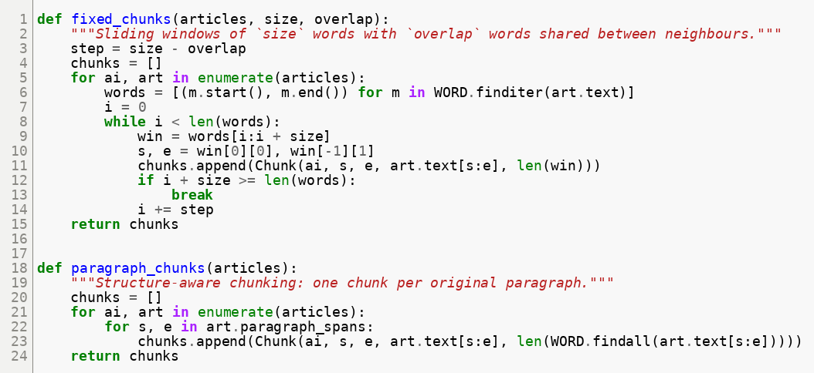{width=13cm}

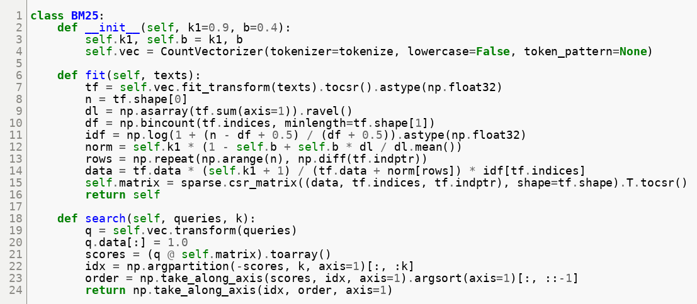{width=13cm}

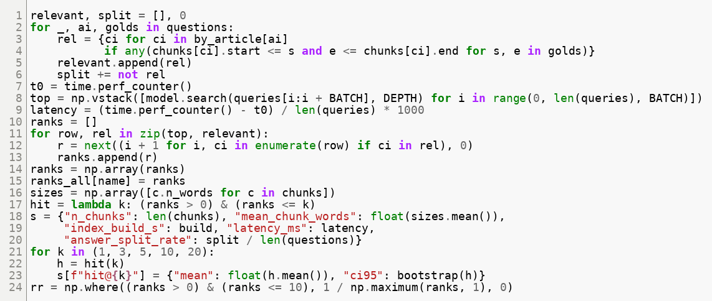{width=13cm}

**Statistics.** For every metric a 95% confidence interval was estimated with the bootstrap (2,000 resamples of questions) [@efron1993]. Since all strategies answer the same questions, they were compared with the paired McNemar test on Hit@5 [@mcnemar1947], which is recommended for comparing two systems on one test set [@dietterich1998]. Seven planned comparisons were made (overlap vs no overlap for four sizes; Paragraph vs Fixed-100 and Fixed-200; Fixed-100 vs Fixed-200), and the p-values were corrected with the Holm method [@holm1979].

**Reproducibility.** The data are downloaded with git from the public SQuAD repository, and one script produces all tables; another draws all charts (Figure 6). The full run of nine strategies takes a few minutes on an ordinary CPU without a GPU.

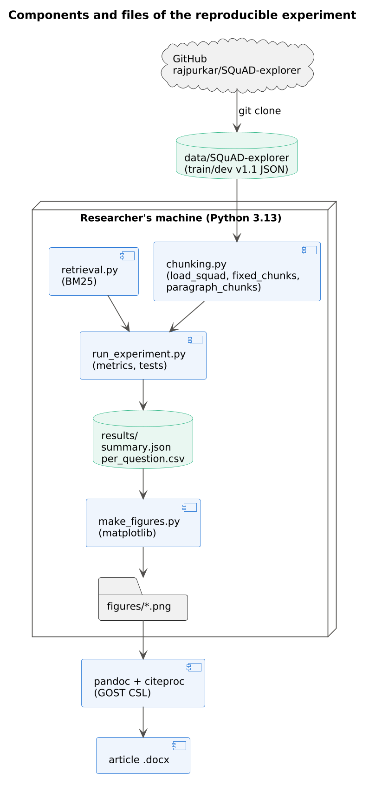{width=5.2cm}

To sum up, the method isolates the chunking strategy: the corpus, questions, retriever and metrics are identical for all nine strategies, and paired tests control for question difficulty. The following section reports what this design revealed.

# Results

**Index size and speed.** Table 2 describes the nine indexes. Halving the chunk size roughly doubles the number of chunks, and a 25% overlap adds about 31% more chunks. Nevertheless, all indexes were built in 1.8–3.1 s, and a query took 0.2–2.6 ms, so none of the strategies is expensive for a corpus of this size.

Table: Table 2 – Size of the chunk indexes and retrieval speed

| Strategy | Chunks | Mean words | Answer split, % | Build, s | Query, ms |
|:---------------------|-------:|-------:|-------:|-------:|-------:|
| Fixed-50 | 49,396 | 49.8 | 2.34 | 2.5 | 2.05 |
| Fixed-50 +25% overlap | 64,760 | 49.9 | 0.02 | 3.0 | 2.61 |
| Fixed-100 | 24,816 | 99.0 | 1.19 | 2.5 | 0.81 |
| Fixed-100 +25% overlap | 32,846 | 99.4 | 0.00 | 3.1 | 1.04 |
| Fixed-200 | 12,526 | 196.2 | 0.62 | 2.1 | 0.38 |
| Fixed-200 +25% overlap | 16,477 | 197.7 | 0.00 | 2.3 | 0.52 |
| Fixed-400 | 6,383 | 385.0 | 0.37 | 2.2 | 0.18 |
| Fixed-400 +25% overlap | 8,269 | 391.3 | 0.00 | 2.3 | 0.23 |
| Paragraph | 20,963 | 117.2 | 0.00 | 1.8 | 0.60 |

**Retrieval quality at fixed k.** Table 3 gives the main metrics. At a fixed k, quality grows with chunk size: Hit@5 rises from 0.735 for Fixed-50 to 0.878 for Fixed-400. In addition, overlap improves every size, and paragraph chunking reaches the best Hit@1 (0.707) and MRR@10 (0.779) of all strategies.

Table: Table 3 – Retrieval quality of the nine strategies (10,570 questions; 95% bootstrap CI for Hit@5)

| Strategy | Hit@1 | Hit@5 [95% CI] | Hit@20 | MRR@10 | Words in top 5 |
|:---------------------|------:|-------------------:|------:|------:|-------:|
| Fixed-50 | 0.551 | 0.735 [0.726; 0.743] | 0.822 | 0.631 | 249 |
| Fixed-50 +25% overlap | 0.607 | 0.803 [0.795; 0.810] | 0.885 | 0.692 | 249 |
| Fixed-100 | 0.623 | 0.809 [0.801; 0.816] | 0.888 | 0.704 | 495 |
| Fixed-100 +25% overlap | 0.667 | 0.851 [0.844; 0.857] | 0.924 | 0.747 | 497 |
| Fixed-200 | 0.662 | 0.849 [0.842; 0.855] | 0.924 | 0.744 | 981 |
| Fixed-200 +25% overlap | 0.694 | 0.873 [0.866; 0.879] | 0.943 | 0.771 | 988 |
| Fixed-400 | 0.681 | 0.878 [0.872; 0.885] | 0.946 | 0.766 | 1,925 |
| Fixed-400 +25% overlap | 0.697 | 0.884 [0.878; 0.890] | 0.952 | 0.778 | 1,956 |
| Paragraph | **0.707** | 0.872 [0.865; 0.878] | 0.936 | **0.779** | 586 |

Figure 7 plots Hit@5 against chunk size. The overlap curve lies above the no-overlap curve at every size, but the gap narrows as chunks grow; paragraph chunking lies above both curves for its size.

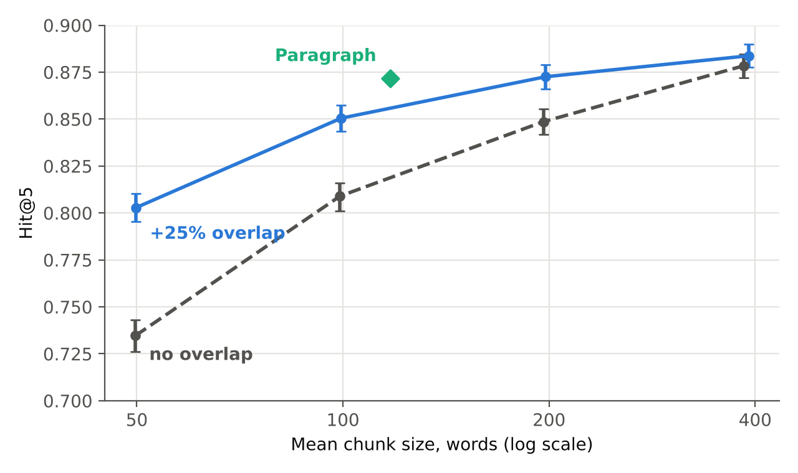{width=11cm}

**Effect of overlap (H1).** Figure 8 explains why the gap narrows. Without overlap, 2.34% of answers are cut by a boundary at 50 words, and 0.37% at 400 words; with overlap, practically none are cut (2 of 10,570 questions at 50 words). Correspondingly, the Hit@5 gain from overlap falls from +6.8 to +0.5 percentage points.

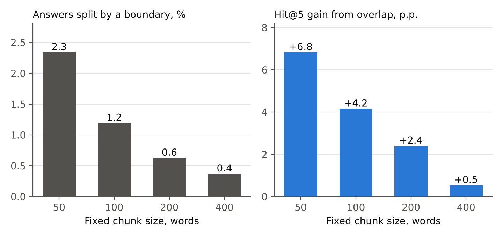{width=13cm}

Table 4 confirms that all four gains are statistically significant after the Holm correction. For example, at 100 words, overlap found 696 questions that the plain chunks missed, while the reverse happened 257 times.

Table: Table 4 – Paired McNemar tests on Hit@5 (Holm-corrected p-values)

| Comparison (A vs B) | Only A hit | Only B hit | p (Holm) |
|:----------------------------|--------:|--------:|---------:|
| Fixed-50 vs +25% overlap | 401 | 1,122 | 3.2·10⁻⁷⁵ |
| Fixed-100 vs +25% overlap | 257 | 696 | 4.3·10⁻⁴⁵ |
| Fixed-200 vs +25% overlap | 222 | 475 | 4.1·10⁻²¹ |
| Fixed-400 vs +25% overlap | 234 | 290 | 0.016 |
| Paragraph vs Fixed-100 | 870 | 207 | 1.2·10⁻⁸⁹ |
| Paragraph vs Fixed-200 | 546 | 302 | 1.4·10⁻¹⁶ |
| Fixed-100 vs Fixed-200 | 206 | 625 | 6.0·10⁻⁴⁷ |

**Effect of size at fixed k and at fixed budget (H2).** Figure 9 shows complete Hit@k curves. At every k, Fixed-400 is above Fixed-100, and the difference Fixed-100 vs Fixed-200 is significant (Table 4). However, the comparison changes when the context length is fixed (Figure 10). With a budget of 400 words, Fixed-400 can pass only one chunk and reaches 0.681, whereas Fixed-50 with overlap passes eight chunks and reaches 0.836, Fixed-100 with overlap 0.833, and paragraphs 0.835. At 800 and 1,600 words paragraphs give the highest values (0.883 and 0.920), and Fixed-400 with overlap remains the lowest (0.801 and 0.868).

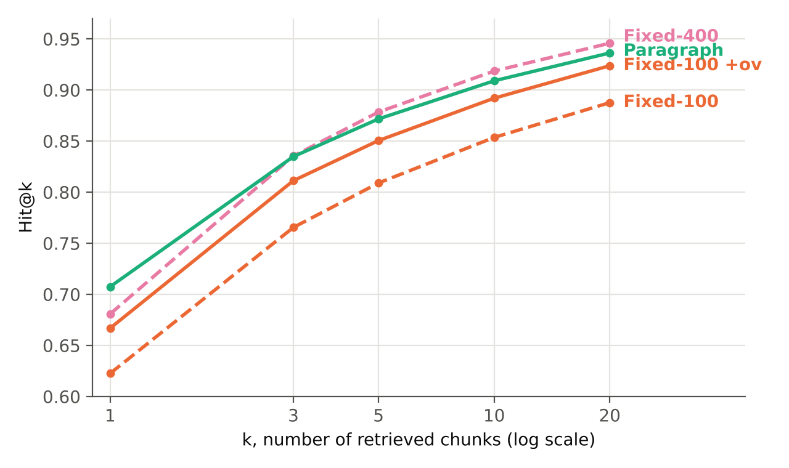{width=11cm}

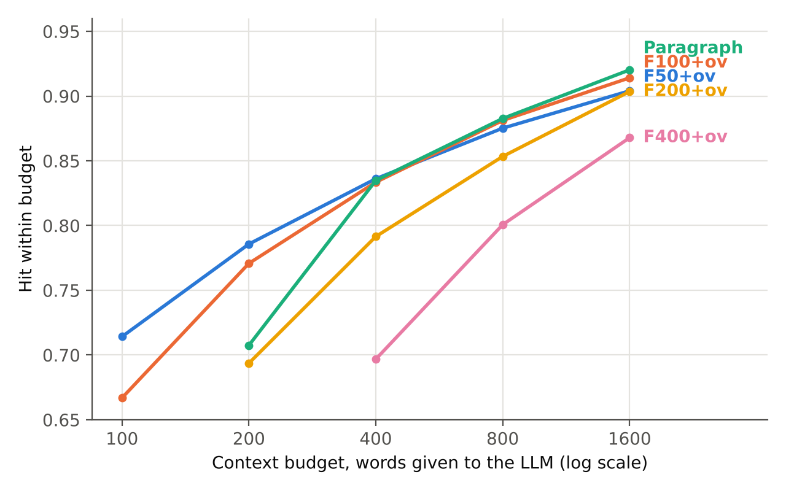{width=11cm}

**Paragraph chunking (H3).** Paragraph chunks are only 18% longer than Fixed-100 chunks, but they win the paired comparison 870 to 207 questions, and they also beat the twice longer Fixed-200 chunks (546 to 302). Moreover, they never cut an answer, because SQuAD answers never cross paragraph borders.

Overall, the results support all three hypotheses: overlap helps at every size, larger chunks win only when the number of chunks rather than the number of words is fixed, and paragraphs are the strongest strategy per word of context. The next section interprets these findings and their limits.

# Discussion

The first finding is that overlap is a cheap and safe improvement. It costs about 31% more chunks and slightly slower queries, yet it raised Hit@5 for every size tested. The mechanism is visible in Figure 8: overlap guarantees that any span shorter than the overlap lies completely inside some chunk. Furthermore, overlap also helps beyond boundary cases, because a fact near a boundary now appears together with more of its context in one of the two neighbouring chunks. The benefit, however, shrinks for large chunks, where few answers are near a border; at 400 words the gain is only 0.5 points.

The second finding concerns the trade-off between chunk size and context cost. Large chunks look better in the usual "top-5" tables (Table 3), but this comparison hides that five 400-word chunks give the LLM almost 2,000 words, eight times more than five 50-word chunks. When the context budget is fixed, the ranking reverses (Figure 10). This agrees with Chen et al., who found finer retrieval units better under a fixed word budget [@chen2024densex], and it matters in practice: longer prompts raise serving cost [@kwon2023], and answers placed in the middle of long contexts are used less reliably [@liu2024lost]. Hence, chunk size and k should be chosen together, from the budget, rather than separately.

The third finding is that respecting the document structure pays off. Paragraphs are written by authors as units of meaning, so a paragraph chunk rarely mixes two topics and rarely cuts a sentence. This explains why Paragraph had the best Hit@1 and MRR, which matter most when only one or two chunks fit into the prompt. This result is consistent with Qu et al.: a simple structure-based rule was competitive, so expensive semantic chunking is not necessary as a first step [@qu2024semantic].

Figure 11 shows where these findings enter a real RAG service: the chunk size and overlap are fixed at indexing time, while k is derived from the context budget at query time. Figure 12 shows a prototype settings screen that makes this trade-off visible to an administrator by displaying the expected hit for the chosen budget.

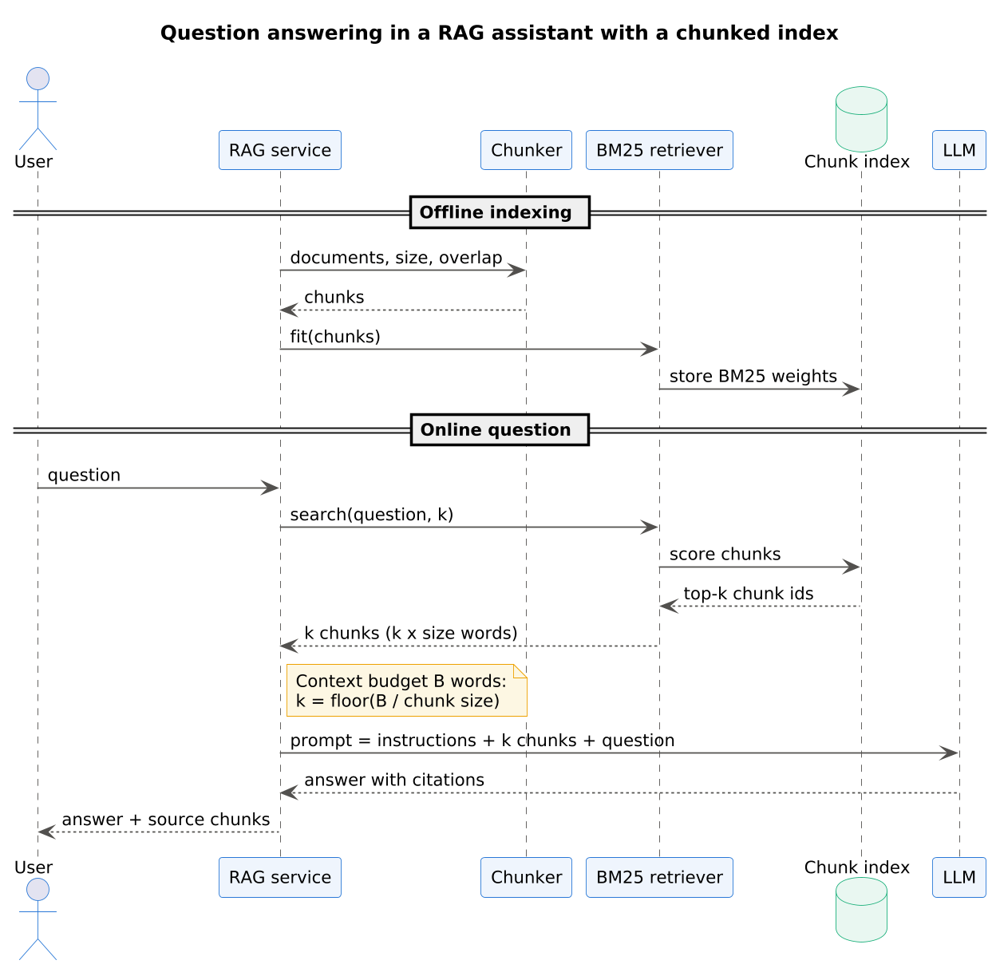{width=10cm}

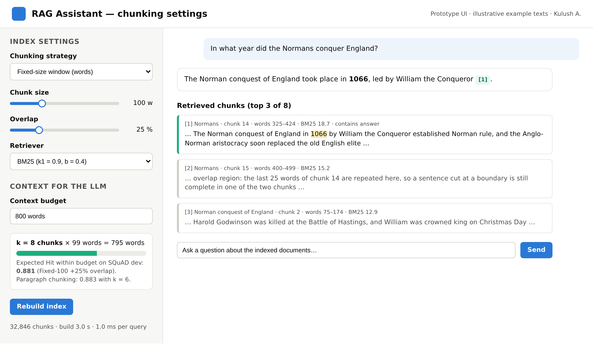{width=13.5cm}

This study has limitations. First, only the retrieval stage was measured; the LLM answer itself was not generated, so the link to answer quality is assumed from earlier work [@lewis2020; @es2024]. Second, only BM25 was used; dense retrievers [@karpukhin2020; @reimers2019] could react differently to chunk size. Third, SQuAD answers are short and always lie inside one paragraph, which favours paragraph chunking; questions that need several paragraphs may prefer larger units [@sarthi2024raptor]. Finally, the budget metric counts overlapping words twice, which slightly penalises overlap, so the reported overlap gains are conservative.

In short, the findings agree with the literature where it exists and extend it with paired statistical tests and a budget-based comparison; at the same time, the limitations define the next experiments. The conclusion summarises the practical outcome.

# Conclusion

This paper measured how chunking affects retrieval in a RAG pipeline using nine strategies, 490 Wikipedia articles and 10,570 SQuAD questions. Three conclusions follow. First, a 25% overlap improved Hit@5 for every chunk size (by 0.5–6.8 points, all significant) and removed answers split by boundaries. Second, larger chunks win at a fixed k only because they give the model more text; at an equal budget of 400 words, 50–100-word overlapping chunks and paragraphs reached about 0.83–0.84 versus 0.68 for 400-word chunks. Third, paragraph chunking gave the best Hit@1 and MRR@10 and the best results at 800–1,600-word budgets.

For practitioners, the results suggest a simple default for a new RAG system: split by paragraphs when the documents have them, otherwise use about 100-word chunks with 25% overlap, and choose k from the context budget. Future work will repeat the experiment with dense retrievers, with generated answers evaluated end to end, and with multi-paragraph questions.

::: {custom-style="Abstract Text"}
**About the author.** Kulush Askhat — student of group IT1CCO-2402IS, International Information Technology University, Almaty, Kazakhstan. Research interests: retrieval-augmented generation, information retrieval, AI platforms.
:::

::: {custom-style="Abstract Text"}
**Data and code availability.** The code, results and figure sources are available in the project repository (folder midterm-1-article); the SQuAD v1.1 data are taken from https://github.com/rajpurkar/SQuAD-explorer.
:::

# References {-}

::: {#refs}
:::
