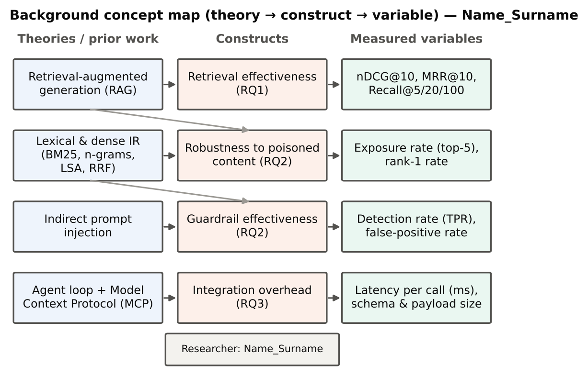
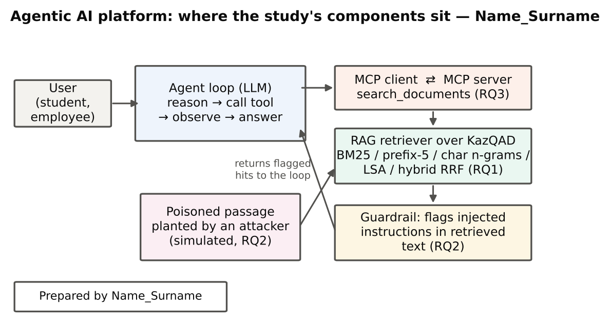

# 1. Introduction

## 1.1 Topic overview

Large language models (LLMs) are increasingly used not as stand-alone chatbots but as the reasoning core of *agents*: programs that repeatedly decide what to do, call external tools, observe the results and continue until a task is complete [@yao2023react; @wang2024survey]. For an organisation such as a university, the most important tool of such an agent is a search over its own documents, because the model must answer from current, local knowledge rather than from what it memorised during training. This combination of retrieval and generation is known as retrieval-augmented generation (RAG) [@lewis2020]. Since November 2024 the Model Context Protocol (MCP) has offered a standard way to expose such tools to any compatible agent [@anthropic2024mcp; @mcp_spec], and the protocol is now governed by the Agentic AI Foundation of the Linux Foundation [@lf2025aaif].

The previous practical works of this course designed an open agentic AI platform for Kazakhstani organisations that combines an agent loop, MCP tools and RAG over Kazakh, Russian and English documents. This report presents a small-scale study of the component on which every answer of such a platform depends: the retrieval tool. It asks how well different retrieval methods find relevant Kazakh passages, how easily an attacker can push malicious content into the agent's context through the same tool, and how much it costs to serve the tool through MCP. The study is motivated by national policy, which sets the goal of developing domestic AI solutions and regulates their safe use [@kz2024aiconcept; @kz2025ailaw], and by the scarcity of evaluations for the Kazakh language [@yeshpanov2024kazqad; @togmanov2025].

## 1.2 Focused literature review

**Retrieval for RAG.** Lewis et al. [@lewis2020] showed that adding a retriever to a generator makes answers more specific and factual and allows knowledge to be updated without retraining. Surveys describe how RAG has evolved towards modular pipelines with query rewriting, hybrid search and reranking [@gao2023; @fan2024]. The classical lexical ranking function BM25 remains a strong baseline [@robertson2009], dense neural retrievers can surpass it when trained on large question–passage collections [@karpukhin2020], and older unsupervised dense methods such as latent semantic analysis (LSA) map documents into a low-dimensional space without labelled data [@deerwester1990]. Reciprocal rank fusion (RRF) combines the rankings of several systems and often outperforms each of them [@cormack2009]. Retrieval quality matters even when long contexts are available, because models use information in the middle of long inputs poorly [@liu2024lost].

**Morphology and low-resource languages.** Kazakh, like Turkish, is agglutinative: a single stem appears with many suffixes, so exact word matching misses relevant documents. For Turkish, simply truncating words to their first five characters was found to be as effective as linguistically elaborate stemmers [@can2008]. For Kazakh, the KazQAD dataset provides more than 800 000 Wikipedia passages, questions from the Unified National Testing (UNT) exam and passage-level relevance judgements; its best published baseline retriever reached nDCG@10 = 0.389 [@yeshpanov2024kazqad]. KazMMLU shows that LLMs still have gaps in Kazakh-language and regional knowledge [@togmanov2025], which increases the importance of retrieval.

**Agents, tools and MCP.** ReAct interleaves reasoning with tool calls in a loop [@yao2023react], Toolformer shows that models can learn when to call tools [@schick2023], and benchmarks show that tool-using agents still fail frequently on realistic tasks [@yao2025tau]. MCP standardises how tools are discovered and called; Hou et al. [@hou2026] analysed its architecture and threats, and new benchmarks evaluate agents on real MCP servers [@luo2025].

**Security of retrieved content.** Greshake et al. [@greshake2023] demonstrated *indirect prompt injection*: instructions hidden in content that an application retrieves are executed by the model. MCP-connected agents can be coerced into harmful tool use [@radosevich2025], and the OWASP Top 10 for LLM applications lists prompt injection as the first risk [@owasp2025llm].

: Table 1. Positioning of the study in the literature – Name_Surname

| Theme | What prior work established | Gap addressed in this study |
|----------------|-------------------------------------------|------------------------------------|
| RAG retrieval | Retrieval improves factuality; BM25, dense retrieval and fusion are standard options [@lewis2020; @robertson2009; @cormack2009] | Which option works best for Kazakh questions under identical conditions |
| Morphology | Prefix truncation works for Turkish [@can2008]; Kazakh baselines exist [@yeshpanov2024kazqad] | Effect of prefix-5 and character n-grams on Kazakh retrieval |
| Security | Indirect prompt injection through retrieved content [@greshake2023; @owasp2025llm] | How often each retriever surfaces planted passages; how well a simple guardrail detects them |
| MCP | Standard tool interface, rapid adoption, threat analyses [@mcp_spec; @hou2026] | Measured latency overhead of serving retrieval as an MCP tool |

{width=95%}

## 1.3 Research problem, questions and hypotheses

**Research problem.** An agentic platform for Kazakhstani organisations needs a retrieval tool that finds relevant Kazakh passages, does not hand attacker-controlled content to the agent unnoticed, and can be integrated through MCP without noticeable cost. Evidence on all three properties for the Kazakh language is missing.

* **RQ1 (effectiveness).** Which retrieval method — BM25 over words, BM25 over prefix-5 truncated words, TF-IDF over character n-grams, LSA, or hybrid RRF — retrieves relevant Kazakh passages best?
  * *H1a:* the hybrid RRF run achieves the highest nDCG@10.
  * *H1b:* sub-word representations (prefix-5, character n-grams) outperform word-level BM25.
* **RQ2 (robustness).** How often does each retriever place an attacker's poisoned passage in the top-5 results, and how well does a pattern-based guardrail detect such passages?
  * *H2a:* lexical retrievers expose the agent to a poisoned passage in more than half of the attacks.
  * *H2b:* the guardrail detects at least 90 % of injected passages with a false-positive rate below 1 %.
* **RQ3 (integration).** What latency overhead does serving retrieval as an MCP tool add compared with an in-process call?
  * *H3:* the median overhead is below 10 ms per call.

{width=90%}

## 1.4 Significance

*Theoretical value:* the study adds controlled evidence on how morphology-aware lexical retrieval, character n-grams, unsupervised dense vectors and rank fusion compare for an agglutinative low-resource language, and connects retrieval quality with security exposure — two properties usually studied separately. *Practical value:* the results give the platform designed in this course an evidence-based default retriever, a realistic expectation of what pattern-based guardrails can and cannot catch, and a measured cost of MCP integration. *Contribution:* a fully reproducible pipeline — data preparation, five retrievers, an attack simulation, an MCP server and statistical analysis — that can be rerun on other Kazakh corpora.

**Summary.** The introduction placed the study within research on RAG, retrieval for agglutinative languages, tool-using agents, MCP and indirect prompt injection. The literature shows that retrieval quality determines what an agent knows, that Kazakh morphology complicates exact word matching, and that retrieved content can carry malicious instructions. These strands meet in one problem: the retrieval tool of a Kazakh-language agentic platform must be effective, must not silently expose the agent to attacks and must be cheap to integrate through MCP. Three research questions and five hypotheses follow from this problem. The concept map links each theory to a construct and to a measurable variable, and the architecture diagram shows where each component sits in the platform. The study is significant both for retrieval research on Kazakh and for the practical design of the platform.
