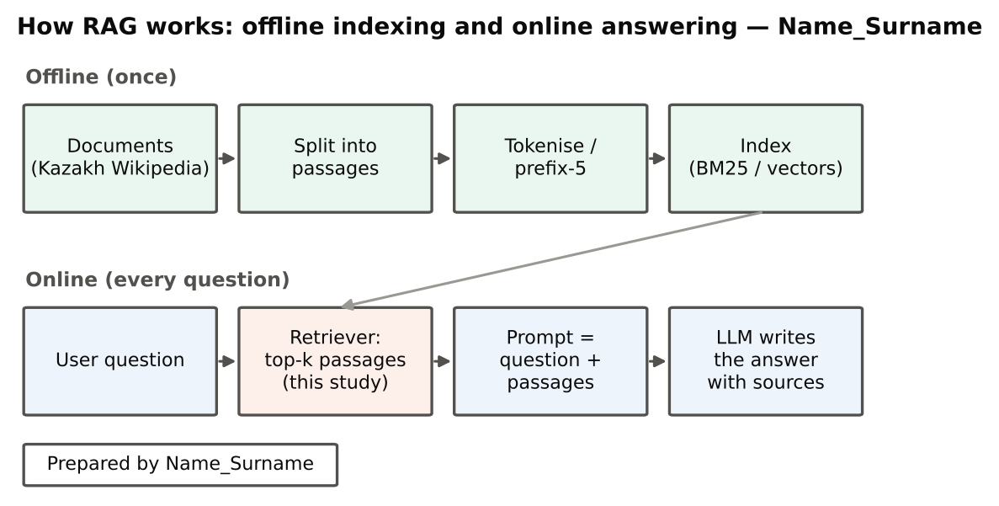

# 1. Introduction

## 1.1 Topic overview

Large language models (LLMs) write fluent text, but they know only what they saw during training: they do not know a university's current regulations, schedules or internal documents, and they sometimes invent facts. **Retrieval-augmented generation (RAG)** solves this in a simple way [@lewis2020]. Documents are split into short passages and indexed in advance; when a user asks a question, a *retriever* finds the most relevant passages, they are added to the prompt, and the model writes the answer from them, ideally citing the sources (Figure 2). RAG is the most common way to connect an AI platform to an organisation's knowledge, because it needs no retraining of the model and the knowledge can be updated by re-indexing documents [@gao2023; @fan2024].

Because the model can only use what the retriever gives it, **the retriever is the weakest link of RAG**: if the right passage is not retrieved, the answer will be wrong or invented. For Kazakh this is especially important. Kazakh is an agglutinative language — one word stem appears with many suffixes (for example *кітап, кітаптар, кітаптарымыздан*) — so a question and a passage often use different word forms of the same stem. This report studies which simple retrieval method works best for Kazakh in a RAG pipeline. It is a small, practical part of the AI platform designed in this course, and it supports the national goal of developing AI solutions that work in the Kazakh language [@kz2024aiconcept].

## 1.2 Focused literature review

**RAG.** Lewis et al. [@lewis2020] combined a neural retriever with a generator and showed more factual answers than the generator alone. Surveys describe how RAG systems have developed from "retrieve then read" pipelines to modular systems with hybrid search and reranking [@gao2023; @fan2024]. Even models that accept long inputs use information in the middle of long contexts poorly, so a good retriever that puts the right passages first remains important [@liu2024lost].

**Lexical retrieval.** BM25 ranks passages by how many query words they contain, how rare those words are and how long the passage is; it remains a strong baseline in information retrieval [@robertson2009; @manning2008]. **Dense retrieval** represents questions and passages as vectors. Neural dense retrievers trained on question–passage pairs can outperform BM25 [@karpukhin2020], and sentence-embedding models make this practical [@reimers2019]; an older, unsupervised dense method is latent semantic analysis (LSA), which compresses a term–document matrix with singular value decomposition [@deerwester1990]. **Hybrid retrieval** combines several rankings; reciprocal rank fusion (RRF) is a simple and popular way to do this [@cormack2009].

**Morphology.** For Turkish, another agglutinative Turkic language, truncating every word to its first five characters was as effective as complex stemmers [@can2008]. For Kazakh, KazQAD provides a corpus of more than 800 000 Wikipedia passages, exam questions and relevance judgements; its best published retriever reached nDCG@10 = 0.389 on the full corpus [@yeshpanov2024kazqad; @kazqad_github]. Benchmarks also show that LLMs have gaps in Kazakh-language knowledge [@togmanov2025], which makes retrieval even more useful.

: Table 1. Positioning of the study in the literature – Name_Surname

| Topic | What is known | What this study adds |
|----------------|-------------------------------------------|------------------------------------|
| RAG | Retrieval makes answers more factual [@lewis2020; @gao2023] | Measures the retrieval step for Kazakh questions |
| Ranking methods | BM25, dense vectors and fusion are standard options [@robertson2009; @deerwester1990; @cormack2009] | Compares them under identical conditions |
| Morphology | Prefix truncation helps Turkish [@can2008] | Tests prefix-5 truncation for Kazakh |
| Kazakh resources | KazQAD dataset and baselines exist [@yeshpanov2024kazqad] | A simple, reproducible pipeline with statistics and speed |

{width=92%}

## 1.3 Research problem, questions and hypotheses

**Problem.** The AI platform needs a retrieval tool for Kazakh documents that is accurate, gives the model enough relevant context and is fast. It is not known which simple method best meets these needs.

* **RQ1.** Which retrieval method finds relevant Kazakh passages best?
  * *H1a:* hybrid RRF gives the highest nDCG@10.
  * *H1b:* prefix-5 truncation improves BM25 compared with full words.
* **RQ2.** How many passages should be passed to the model?
  * *H2:* for the best method, at least 70 % of relevant passages are found within the top 20.
* **RQ3.** How fast are the methods?
  * *H3:* BM25-based search takes less than 10 ms per question on an ordinary CPU.

{width=92%}

## 1.4 Significance

*Theoretical:* the study adds evidence on how simple lexical, sub-word, dense and hybrid retrieval compare for an agglutinative, lower-resource language. *Practical:* it gives the AI platform a tested default retriever, a recommended number of passages per prompt and expected speed. *Contribution:* an open, reproducible pipeline that anyone can rerun with one command.

**Summary.** RAG lets an LLM answer from an organisation's own documents by retrieving relevant passages and adding them to the prompt. The retriever is the weakest link, because the model cannot use what is not retrieved. Kazakh morphology makes exact word matching difficult, and the literature suggests prefix truncation and hybrid ranking as simple remedies. The KazQAD dataset makes it possible to test these methods on real exam questions. Three research questions ask which method is most accurate, how many passages the model needs and how fast the methods are. The answers give the platform an evidence-based default retriever.
