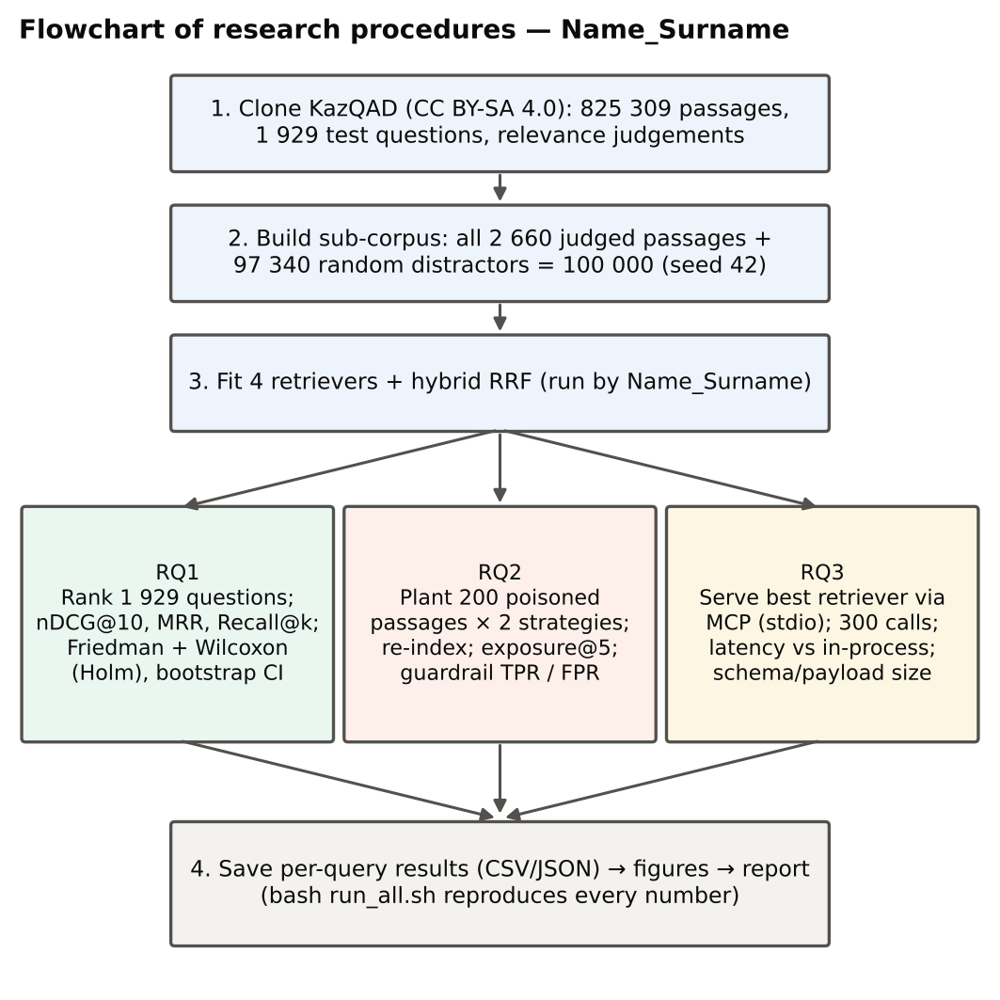

# 2. Methodology

## 2.1 Research design

A **quantitative, computational experimental design** was chosen. The same set of test questions was processed by every retrieval method (a within-subjects, repeated-measures design in which questions act as subjects), which removes between-group variance and allows paired statistical tests. The design matches the research questions: RQ1–RQ3 concern measurable properties of software components — ranking quality, exposure rates, detection rates and latency — and can be answered by controlled manipulation of one factor at a time (retrieval method, attack strategy, call path). A qualitative component was not included in this small-scale study because no human-facing artefact was evaluated; the mixed-methods evaluation with developers and users remains part of the full research plan (Practical Work 5). The design follows the *experimental* and *simulation* approaches described in the course lecture on research methodology: variables are manipulated under controlled conditions, and attacks are simulated against a local index.

: Table 2. Design matrix of the study – Name_Surname

| RQ | Independent variable (levels) | Dependent variables | Instrument | Analysis |
|-----|---------------------------|---------------------|---------------|---------------------|
| RQ1 | Retriever (5 levels) | nDCG@10, MRR@10, Recall@5/20/100, latency | KazQAD test topics and judgements | Bootstrap 95 % CI; Friedman test; Wilcoxon signed-rank with Holm correction; rank-biserial *r* |
| RQ2 | Retriever (5) × attack strategy (full / partial copy); payload variant (5) | Exposure rate in top-5, rank-1 rate, nDCG@10 with/without poison; guardrail TPR and FPR | 200 planted passages per strategy; guardrail patterns | Proportions; detection rates by variant; false-positive count on 100 000 clean passages |
| RQ3 | Call path (in-process / MCP over stdio) | Latency per call (median, p95), start-up time, schema and payload size | MCP server and client (Python SDK) | Paired per-call differences; median and 95th percentile |

## 2.2 Sample, inclusion criteria and ethics

**Questions.** All 1 929 questions of the KazQAD test split were used [@yeshpanov2024kazqad; @kazqad_github]. They are original UNT exam questions in five school subjects: Kazakh history (659), biology (379), literature (368), geography (346) and world history (177). Inclusion criterion: the question has at least one passage judged relevant (all 1 929 satisfied it; 2 718 relevant judgements in total, 1.41 per question). The full test split was used instead of a sample, so no sampling error arises at the question level, and the size gives high statistical power for paired comparisons.

**Corpus.** The full KazQAD corpus contains 825 309 passages. To keep the study small-scale and runnable on a laptop-class machine, a sub-corpus of **100 000 passages** was built: all 2 660 passages judged for the test questions (relevant and non-relevant) plus 97 340 distractor passages drawn by reservoir sampling (random seed 42) from the rest of the corpus; passages shorter than 40 characters (empty or table mark-up) were not used as distractors. Mean passage length is 39.4 words, mean question length 6.9 words.

**Attack sample.** For RQ2, 200 questions were drawn at random (seed 42); for RQ3, 300 questions (seed 7).

**Ethics.** No human participants were involved and no personal data were processed. KazQAD is published under the CC BY-SA 4.0 licence. Attacks were simulated only against a local copy of the index; injected payloads use reserved example addresses (`example.com`). Therefore no ethics-committee approval was required.

## 2.3 Materials and instruments

* **Retrievers** (implemented with scikit-learn and SciPy [@pedregosa2011]):
  1. *BM25 (word)* — Okapi BM25 over lower-cased word tokens, k1 = 0.9, b = 0.4 [@robertson2009];
  2. *BM25 (prefix-5)* — the same with every token truncated to its first five characters [@can2008];
  3. *TF-IDF (char 3–5)* — cosine similarity over character 3–5-grams within word boundaries, sub-linear term frequency;
  4. *LSA (dense 256-d)* — truncated singular value decomposition of prefix-5 TF-IDF vectors into 256 dimensions [@deerwester1990];
  5. *Hybrid RRF* — reciprocal rank fusion (k = 60) of runs 2 and 3 [@cormack2009].
  Each document is indexed as "title + text". Parameters were fixed *a priori* from the cited sources and were not tuned on the test questions.
* **Metrics.** nDCG@10 (primary), MRR@10, Recall@5, Recall@20 and Recall@100, computed against KazQAD binary relevance judgements.
* **Attack generator.** Each poisoned passage contains the question text (full strategy) or every second word of it (partial strategy) followed by one of ten payloads in five variants: explicit English, explicit Russian, explicit Kazakh, paraphrased English and paraphrased Kazakh (Appendix C).
* **Guardrail.** A detector with 13 regular expressions in four groups — instruction override, role/system impersonation, tool invocation and data exfiltration — written from generic attack descriptions [@greshake2023; @owasp2025llm] before the evaluation (Appendix B).
* **MCP server and client.** The best retriever was exposed as the tool `search_documents(query, k)` with the official MCP Python SDK (version 2.2.0) over the stdio transport [@mcp_python_sdk; @mcp_spec]; every hit carries the guardrail's flags.
* **Environment.** 4 virtual CPU cores, 15 GB RAM, Linux, Python 3.13, scikit-learn 1.9.1, SciPy 1.18.1, matplotlib 3.11.2.

**Reliability and validity.** All random choices use fixed seeds and all code is deterministic, so repeated runs give identical effectiveness results; only latency varies with machine load, which is why medians and 95th percentiles are reported. Construct validity of RQ1 relies on KazQAD's manual relevance judgements; RQ2 measures *exposure* (the poisoned passage reaches the context) rather than attack success, which would require an LLM in the loop.

## 2.4 Procedures

The procedure (Figure 3) consisted of five steps, each implemented as a script:

1. `prepare_data.py` — clone KazQAD from GitHub, build the 100 000-passage sub-corpus and compute dataset statistics (≈ 15 s).
2. `run_retrieval.py` — build the four indexes, rank the top-100 passages for all 1 929 questions with each method, fuse runs 2 and 3 with RRF, compute metrics and statistics (≈ 2.2 min).
3. `run_injection.py` — for each attack strategy, add 200 poisoned passages to the corpus, rebuild all indexes, rank the 200 attacked questions, record the poisoned passage's rank; then apply the guardrail to the poisoned passages and to all 100 000 clean passages (≈ 3.4 min).
4. `run_mcp_overhead.py` — start the MCP server as a subprocess, list its tools, make one warm-up call and 300 timed calls; repeat the same 300 calls in-process (≈ 15 s).
5. `make_figures.py` — produce all charts and diagrams from the saved results.

The whole pipeline is started by `bash run_all.sh` and was executed in October 2026. No separate pilot was needed because no instrument was administered to people and no parameter was tuned; correctness of the metric code was checked against hand-computed examples (`test_metrics.py`).

{width=88%}

## 2.5 Data analysis

For each method and metric, the mean over questions and a 95 % bootstrap confidence interval (2 000 resamples) were computed. Differences in nDCG@10 between the five methods were tested with the Friedman test; seven planned pairwise comparisons used the Wilcoxon signed-rank test with Holm correction, and the matched-pairs rank-biserial correlation *r* is reported as effect size (|*r*| ≈ 0.1 small, 0.3 medium, 0.5 large). Exposure and detection results are reported as proportions of attacks, and the false-positive rate as the share of clean passages flagged. Latency is summarised by median and 95th percentile, and the overhead is computed per call as the difference between the MCP and the in-process latency for the same query. All analyses were run in Python (NumPy, SciPy, scikit-learn); raw per-query results are saved as CSV files for re-analysis.

**Summary.** A quantitative, computational within-subjects experiment was chosen because all three research questions concern measurable properties of software components. The full KazQAD test set of 1 929 questions was used with a reproducible 100 000-passage sub-corpus, and attacks were simulated on 200 random questions. Five retrievers with literature-based fixed parameters, an attack generator, a pattern-based guardrail and an MCP server were the instruments. The procedure consists of five scripted steps executed by one command, and all random choices are seeded. Statistical analysis uses bootstrap intervals, Friedman and Holm-corrected Wilcoxon tests with effect sizes, proportions and latency percentiles. Because data, code and parameters are public, any researcher can reproduce every number in this report.
