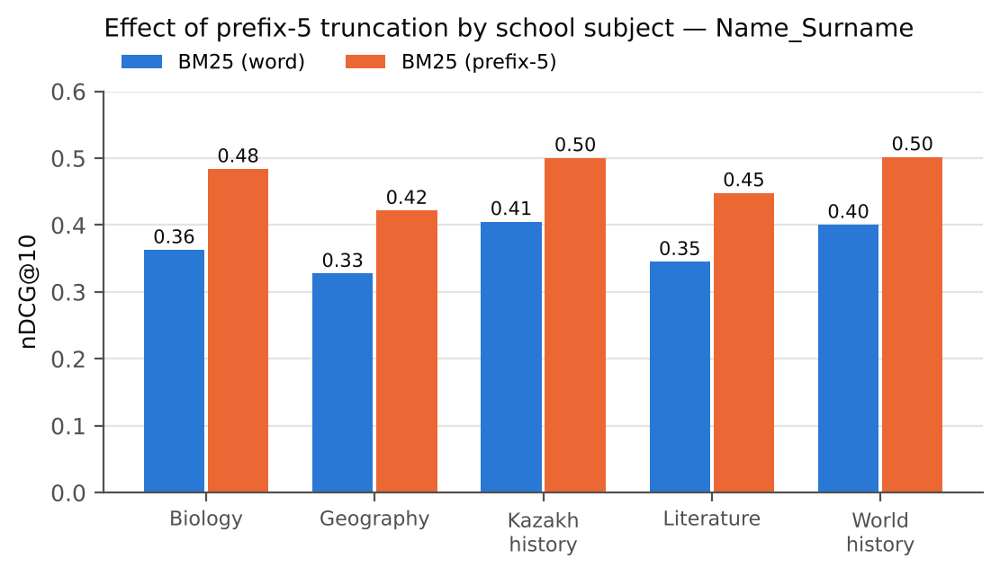
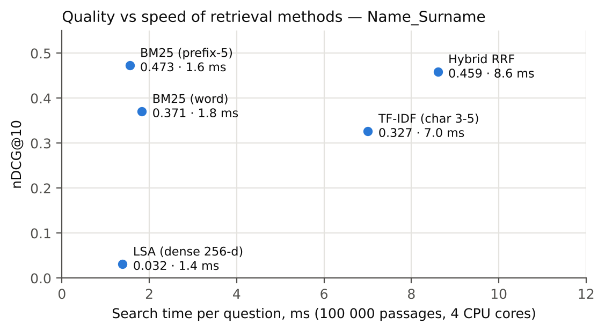

# 3. Results

## 3.1 Description of the data

: Table 3. Descriptive statistics of the evaluation data – Name_Surname

| Characteristic | Value |
|------------------------------------------|-------------------|
| Passages in the full KazQAD corpus | 825 309 |
| Passages in the sub-corpus (judged + random) | 100 000 (2 660 + 97 340) |
| Test questions (all with ≥ 1 relevant passage) | 1 929 |
| Questions by subject: Kazakh history / biology / literature / geography / world history | 659 / 379 / 368 / 346 / 177 |
| Relevant / non-relevant judgements | 2 718 / 653 |
| Mean relevant passages per question | 1.41 |
| Mean question / passage length, words | 6.9 / 39.4 |

## 3.2 RQ1: which method finds relevant passages best

Table 4 and Figure 4 show the quality of the five methods over all 1 929 questions. BM25 with prefix-5 truncation had the highest nDCG@10 (0.473; 95 % CI 0.456–0.490) and MRR@10 (0.456). It was followed by hybrid RRF (0.459 and 0.434), word-level BM25 (0.371 and 0.361), character n-gram TF-IDF (0.327 and 0.292) and LSA (0.032 and 0.030).

: Table 4. Retrieval quality on 1 929 KazQAD test questions (mean, 95 % bootstrap CI) – Name_Surname

| Method | nDCG@10 | MRR@10 | Recall@5 | Recall@20 | Recall@100 |
|------------------|------------------|------------------|--------|--------|--------|
| BM25 (word) | 0.371 (0.354–0.388) | 0.361 (0.343–0.379) | 0.409 | 0.568 | 0.711 |
| BM25 (prefix-5) | **0.473** (0.456–0.490) | **0.456** (0.436–0.475) | **0.533** | 0.712 | 0.850 |
| TF-IDF (char 3–5) | 0.327 (0.312–0.342) | 0.292 (0.276–0.307) | 0.381 | 0.612 | 0.825 |
| LSA (dense 256-d) | 0.032 (0.026–0.038) | 0.030 (0.024–0.036) | 0.034 | 0.093 | 0.265 |
| Hybrid RRF | 0.459 (0.443–0.476) | 0.434 (0.416–0.453) | 0.520 | **0.720** | **0.859** |

{width=90%}

The Friedman test showed that the methods differ, χ²(4) = 2 754.6, *p* < 0.001. All seven pairwise comparisons were significant after Holm correction (Table 5). Prefix-5 truncation improved word-level BM25 by 0.102 (*r* = 0.49, a large effect). Hybrid RRF was 0.014 lower than prefix-5 BM25 (*r* = −0.12, a small effect). Character n-grams were 0.044 lower than word-level BM25 (*r* = −0.21).

: Table 5. Pairwise Wilcoxon signed-rank tests on nDCG@10 (Holm-adjusted) – Name_Surname

| Comparison (A vs B) | Difference A − B | *p* (Holm) | Effect size *r* |
|--------------------------------------|---------|-------------|--------|
| BM25 (prefix-5) vs BM25 (word) | +0.102 | 1.2 × 10⁻⁴² | 0.49 |
| Hybrid RRF vs BM25 (prefix-5) | −0.014 | 0.0016 | −0.12 |
| Hybrid RRF vs BM25 (word) | +0.088 | 2.8 × 10⁻³¹ | 0.41 |
| Hybrid RRF vs TF-IDF (char 3–5) | +0.132 | 7.1 × 10⁻¹¹⁷ | 0.80 |
| Hybrid RRF vs LSA | +0.428 | 3.2 × 10⁻²¹⁸ | 0.99 |
| TF-IDF (char 3–5) vs BM25 (word) | −0.044 | 1.7 × 10⁻⁹ | −0.21 |
| TF-IDF (char 3–5) vs BM25 (prefix-5) | −0.146 | 1.7 × 10⁻⁸¹ | −0.65 |

In practical terms, prefix-5 BM25 placed a relevant passage at the very first position for 34.6 % of the questions and somewhere in the top 10 for 70.1 % of them. The corresponding values were 31.5 % and 70.6 % for hybrid RRF, 26.7 % and 56.9 % for word-level BM25, 17.6 % and 56.8 % for character n-grams, and 1.6 % and 7.0 % for LSA (Table 5a). Compared question by question with word-level BM25, prefix-5 truncation gave a better nDCG@10 for 705 questions, a worse one for 331 and the same value for 893.

: Table 5a. Share of questions with a relevant passage at rank 1 and in the top 10 – Name_Surname

| Method | Relevant at rank 1 | Relevant in top 10 |
|------------------|----------|----------|
| BM25 (word) | 26.7 % | 56.9 % |
| BM25 (prefix-5) | **34.6 %** | 70.1 % |
| TF-IDF (char 3–5) | 17.6 % | 56.8 % |
| LSA (dense 256-d) | 1.6 % | 7.0 % |
| Hybrid RRF | 31.5 % | **70.6 %** |

Prefix-5 BM25 had the highest nDCG@10 in every school subject, from 0.42 in geography to 0.50 in Kazakh history and world history; its advantage over word-level BM25 ranged from 0.09 to 0.12 (Figure 7, Appendix B).

{width=90%}

## 3.3 RQ2: how many passages to pass to the model

Recall grew with the number of passages *k* for every method (Figure 5). For prefix-5 BM25 it was 0.533 at *k* = 5, 0.712 at *k* = 20 and 0.850 at *k* = 100; for hybrid RRF 0.520, 0.720 and 0.859. The number of questions with no relevant passage in the top 100 was 215 for hybrid RRF, 227 for prefix-5 BM25, 270 for character n-grams, 454 for word-level BM25 and 1 338 for LSA.

{width=90%}

## 3.4 RQ3: speed

Average search time per question was 1.4 ms for LSA, 1.6 ms for prefix-5 BM25, 1.8 ms for word-level BM25, 7.0 ms for character n-grams and 8.6 ms for hybrid RRF, which runs two searches (Table 6, Figure 6). Building the index for 100 000 passages took 5.4 s for prefix-5 BM25, 6.9 s for word-level BM25, 19.8 s for LSA and 66.7 s for character n-grams.

: Table 6. Speed of the methods (100 000 passages, 4 CPU cores) – Name_Surname

| Method | Search time, ms per question | Index build time, s |
|------------------|----------------|----------------|
| BM25 (word) | 1.8 | 6.9 |
| BM25 (prefix-5) | 1.6 | 5.4 |
| TF-IDF (char 3–5) | 7.0 | 66.7 |
| LSA (dense 256-d) | 1.4 | 19.8 |
| Hybrid RRF | 8.6 | 72.1 (both indexes) |

{width=90%}

**Summary.** The evaluation used 1 929 Kazakh exam questions and 100 000 passages. Prefix-5 BM25 reached the highest nDCG@10 (0.473) and MRR@10 (0.456), hybrid RRF the highest Recall@20 and Recall@100, and LSA the lowest values on all measures. All pairwise differences were statistically significant, with a large effect for prefix-5 over word-level BM25 and a small effect between prefix-5 BM25 and hybrid RRF. Prefix-5 BM25 led in every school subject. Recall of the best methods rose from about 0.53 at five passages to about 0.71–0.72 at twenty. BM25 searches took under 2 ms per question, while the hybrid run took 8.6 ms. These observations are interpreted in the Discussion.
