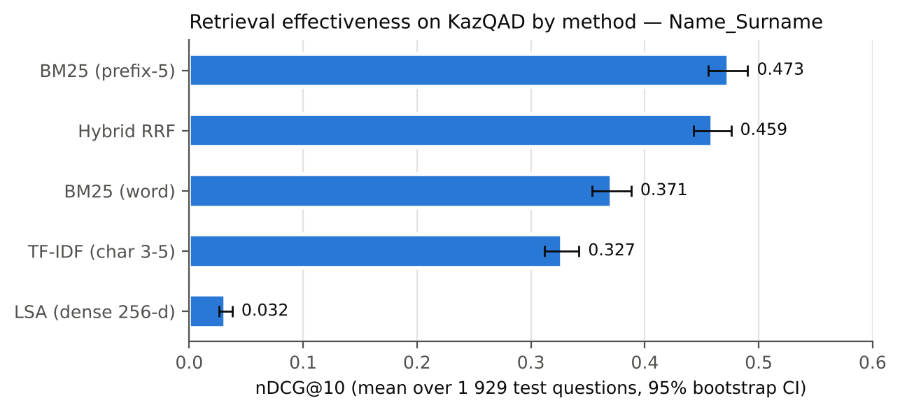
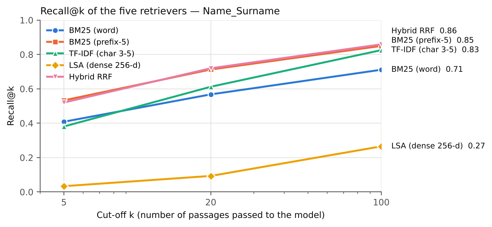
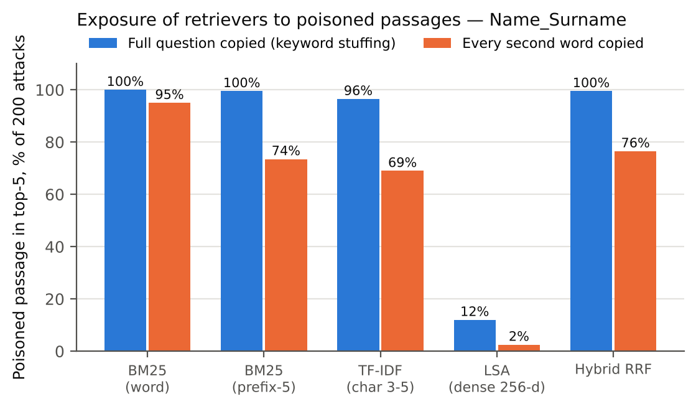
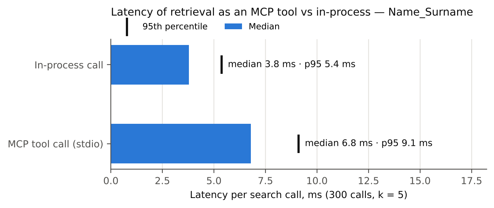

# 3. Results

## 3.1 Description of the data

: Table 3. Descriptive statistics of the evaluation data – Name_Surname

| Characteristic | Value |
|------------------------------------------|-------------------|
| Passages in the full KazQAD corpus | 825 309 |
| Passages in the sub-corpus (judged + distractors) | 100 000 (2 660 + 97 340) |
| Test questions (all with ≥ 1 relevant passage) | 1 929 |
| Questions by subject: Kazakh history / biology / literature / geography / world history | 659 / 379 / 368 / 346 / 177 |
| Relevant / non-relevant judgements | 2 718 / 653 |
| Mean relevant passages per question | 1.41 |
| Mean question length / passage length, words | 6.9 / 39.4 |

## 3.2 RQ1: retrieval effectiveness

Table 4 and Figure 4 report the effectiveness of the five retrievers over all 1 929 questions. BM25 with prefix-5 truncation obtained the highest nDCG@10 (0.473; 95 % CI 0.456–0.490) and MRR@10 (0.456), followed by hybrid RRF (0.459 and 0.434), word-level BM25 (0.371 and 0.361), character n-gram TF-IDF (0.327 and 0.292) and LSA (0.032 and 0.030). At the deeper cut-off of 100 passages, hybrid RRF had the highest recall (0.859), followed by prefix-5 BM25 (0.850) and character n-grams (0.825); word-level BM25 reached 0.711 and LSA 0.265 (Figure 5). The number of questions without any relevant passage in the top 100 was 215 for hybrid RRF, 227 for prefix-5 BM25, 270 for character n-grams, 454 for word-level BM25 and 1 338 for LSA.

: Table 4. Retrieval effectiveness and efficiency on 1 929 KazQAD test questions (mean, 95 % bootstrap CI) – Name_Surname

| Method | nDCG@10 | MRR@10 | Recall@5 | Recall@20 | Recall@100 | Latency, ms/query | Index build, s |
|----------------|------------------|------------------|-------|-------|-------|-------|-------|
| BM25 (word) | 0.371 (0.354–0.388) | 0.361 (0.343–0.379) | 0.409 | 0.568 | 0.711 | 1.8 | 6.9 |
| BM25 (prefix-5) | **0.473** (0.456–0.490) | **0.456** (0.436–0.475) | **0.533** | 0.712 | 0.850 | 1.6 | 5.4 |
| TF-IDF (char 3–5) | 0.327 (0.312–0.342) | 0.292 (0.276–0.307) | 0.381 | 0.612 | 0.825 | 7.0 | 66.7 |
| LSA (dense 256-d) | 0.032 (0.026–0.038) | 0.030 (0.024–0.036) | 0.034 | 0.093 | 0.265 | 1.4 | 19.8 |
| Hybrid RRF | 0.459 (0.443–0.476) | 0.434 (0.416–0.453) | 0.520 | **0.720** | **0.859** | 8.6 | (two indexes) |

{width=92%}

{width=92%}

The Friedman test showed a significant difference in nDCG@10 between the five methods, χ²(4) = 2 754.6, *p* < 0.001. All seven planned pairwise comparisons were significant after Holm correction (Table 5). The largest effects were observed for hybrid RRF versus LSA (*r* = 0.99) and versus character n-grams (*r* = 0.80); prefix-5 truncation improved on word-level BM25 by 0.102 (*r* = 0.49); hybrid RRF scored 0.014 lower than prefix-5 BM25 (*r* = −0.12); character n-grams scored 0.044 lower than word-level BM25 (*r* = −0.21).

: Table 5. Pairwise Wilcoxon signed-rank tests on nDCG@10 (Holm-adjusted) – Name_Surname

| Comparison (A vs B) | Mean difference A − B | *p* (Holm) | Rank-biserial *r* |
|--------------------------------------|---------|-------------|--------|
| Hybrid RRF vs BM25 (word) | +0.088 | 2.8 × 10⁻³¹ | 0.41 |
| Hybrid RRF vs BM25 (prefix-5) | −0.014 | 0.0016 | −0.12 |
| Hybrid RRF vs TF-IDF (char 3–5) | +0.132 | 7.1 × 10⁻¹¹⁷ | 0.80 |
| Hybrid RRF vs LSA | +0.428 | 3.2 × 10⁻²¹⁸ | 0.99 |
| BM25 (prefix-5) vs BM25 (word) | +0.102 | 1.2 × 10⁻⁴² | 0.49 |
| TF-IDF (char 3–5) vs BM25 (word) | −0.044 | 1.7 × 10⁻⁹ | −0.21 |
| TF-IDF (char 3–5) vs BM25 (prefix-5) | −0.146 | 1.7 × 10⁻⁸¹ | −0.65 |

By subject (Appendix E), prefix-5 BM25 had the highest nDCG@10 in all five subjects (0.422 in geography to 0.502 in world history). Character n-grams scored above word-level BM25 only in biology (0.370 vs 0.363).

## 3.3 RQ2: exposure to poisoned passages and guardrail detection

When the attacker copied the full question into the poisoned passage, the passage appeared in the top-5 results in 100 % of the 200 attacks for word-level BM25, 99.5 % for prefix-5 BM25 and hybrid RRF, 96.5 % for character n-grams and 12 % for LSA (Table 6, Figure 6). It was ranked first in 89–99.5 % of attacks for the four lexical methods. When only every second word of the question was copied, exposure in the top-5 was 95 % (word-level BM25), 76.5 % (hybrid RRF), 73.5 % (prefix-5 BM25), 69 % (character n-grams) and 2.5 % (LSA). For the attacked questions, the presence of poisoned passages lowered nDCG@10 of prefix-5 BM25 from 0.499 to 0.355 (full copy) and to 0.453 (partial copy).

: Table 6. Exposure to 200 poisoned passages per strategy – Name_Surname

| Method | In top-5, full copy | Rank 1, full copy | In top-5, partial copy | Rank 1, partial copy | nDCG@10 clean → with poison (full) |
|--------------|---------|---------|---------|---------|----------------------|
| BM25 (word) | 100.0 % | 99.5 % | 95.0 % | 69.5 % | 0.381 → 0.268 |
| BM25 (prefix-5) | 99.5 % | 99.0 % | 73.5 % | 32.0 % | 0.499 → 0.355 |
| TF-IDF (char 3–5) | 96.5 % | 89.0 % | 69.0 % | 37.5 % | 0.333 → 0.247 |
| LSA (dense 256-d) | 12.0 % | 6.0 % | 2.5 % | 1.0 % | 0.038 → 0.036 |
| Hybrid RRF | 99.5 % | 97.0 % | 76.5 % | 40.0 % | 0.477 → 0.337 |

{width=92%}

The guardrail detected all 120 explicit injections (40 English, 40 Russian, 40 Kazakh) and none of the 80 paraphrased injections (40 English, 40 Kazakh) (Table 7). On the 100 000 clean passages it raised 354 alarms (false-positive rate 0.354 %): 353 from the e-mail-address pattern and one from the role pattern. None of the flagged clean passages was a passage judged relevant to a test question.

: Table 7. Guardrail detection by payload variant and false alarms on the clean corpus – Name_Surname

| Payload variant | Poisoned passages | Detected | Detection rate |
|-------------------------------|------|------|---------|
| Explicit, English | 40 | 40 | 100 % |
| Explicit, Russian | 40 | 40 | 100 % |
| Explicit, Kazakh | 40 | 40 | 100 % |
| Paraphrased, English | 40 | 0 | 0 % |
| Paraphrased, Kazakh | 40 | 0 | 0 % |
| **Clean passages flagged (false positives)** | 100 000 | 354 | 0.354 % |

## 3.4 RQ3: overhead of MCP integration

Over 300 calls with k = 5, the in-process search took a median of 3.8 ms (95th percentile 5.4 ms) and the same search through the MCP server took 6.8 ms (p95 9.1 ms) (Figure 7). The per-call overhead had a median of 3.0 ms (mean 3.3 ms, p95 5.0 ms), i.e. 44 % of the median MCP call time. Starting the server and completing the protocol handshake took 2.5 s; listing the tools took 4.3 ms; the JSON description of the tool occupied 719 bytes, and the median response for five hits was 10.1 KB.

{width=92%}

: Table 8. MCP integration measurements (300 calls, k = 5) – Name_Surname

| Measure | In-process | MCP (stdio) | Difference |
|--------------------------------|-------------|-------------|-------------|
| Median latency per call, ms | 3.8 | 6.8 | +3.0 |
| 95th percentile, ms | 5.4 | 9.1 | +5.0 (p95 of per-call differences) |
| Start-up (load index / start server + handshake) | — | 2.5 s | — |
| `list_tools` round trip, ms | — | 4.3 | — |
| Tool schema size / median response size | — | 719 B / 10.1 KB | — |

**Summary.** The evaluation used 1 929 Kazakh questions and a 100 000-passage sub-corpus. Prefix-5 BM25 achieved the highest nDCG@10 (0.473) and MRR@10 (0.456), hybrid RRF the highest Recall@100 (0.859), and LSA the lowest values on all measures; all pairwise differences were statistically significant. Poisoned passages that copied the question entered the top-5 in 96.5–100 % of attacks for the four lexical methods and in 12 % for LSA; with partial copying, exposure ranged from 69 % to 95 % for lexical methods. The guardrail detected 100 % of explicit and 0 % of paraphrased injections and flagged 0.354 % of clean passages, mostly because of e-mail addresses. Serving retrieval through MCP increased the median call latency from 3.8 ms to 6.8 ms. These observations are interpreted in the next section.
