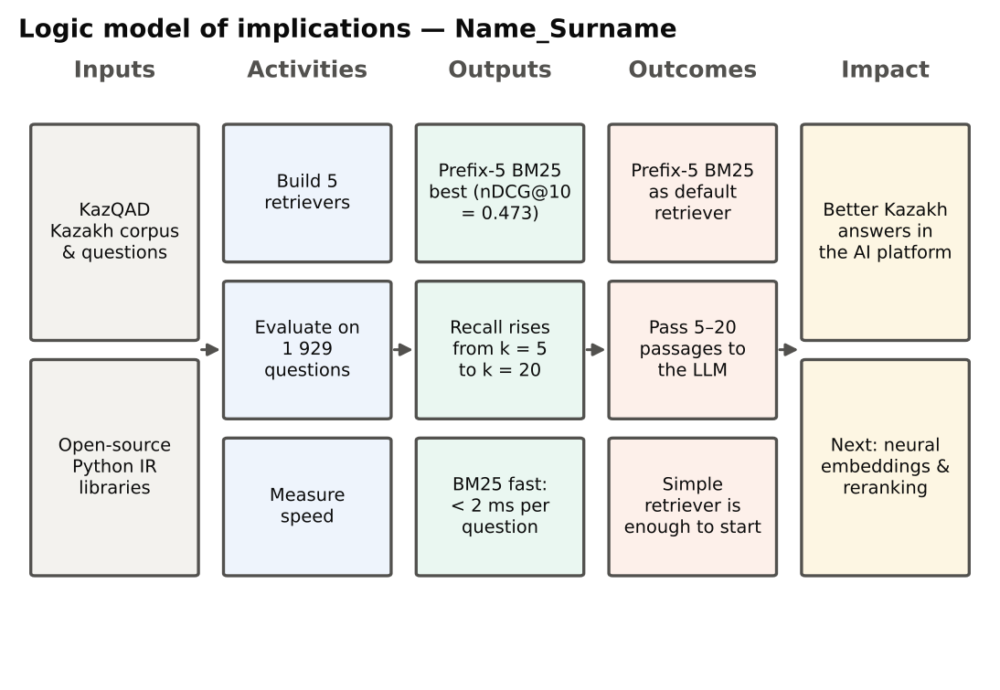

# 4. Discussion

## 4.1 Hypotheses

: Table 7. Hypotheses versus results – Name_Surname

| Hypothesis | Expected | Observed | Verdict |
|------------|------------------------|------------------------------|-----------|
| H1a | Hybrid RRF is best (nDCG@10) | Prefix-5 BM25 is best (0.473); RRF 0.459 | Not supported |
| H1b | Prefix-5 improves BM25 | +0.102 nDCG@10, large effect | Supported |
| H2 | ≥ 70 % recall within top 20 | 71.2 % (prefix-5), 72.0 % (RRF) | Supported |
| H3 | BM25 < 10 ms per question | 1.6–1.8 ms | Supported |

## 4.2 What the results mean

**Prefix-5 works because of Kazakh morphology.** Cutting every word to five letters turns many forms of one word — with case, plural and possessive suffixes — into the same index term, so the question and the passage match even when they use different endings. The improvement of about 27 % over word-level BM25 shows that word-form mismatch is the main problem of simple search in Kazakh. This agrees with the result for Turkish, where five-letter truncation was as good as complex stemmers [@can2008]. It is good news for practice: a one-line change in tokenisation gives a large gain without any language-specific tools.

**Why the hybrid did not win.** Reciprocal rank fusion helps most when the merged rankings are of similar quality and make different mistakes [@cormack2009]. Here the character n-gram ranking was clearly weaker at the top, so mixing it in slightly lowered precision; however, it added some relevant passages deeper in the list, which is why the hybrid had the highest Recall@100. For a simple RAG pipeline that passes the top results directly to the model, prefix-5 BM25 is better; for a pipeline with a second step that re-sorts candidates (a reranker), the hybrid list is a better starting pool [@gao2023].

**Why LSA failed.** LSA compresses all passages into 256 numbers without any training on questions, so it cannot separate the precise facts asked in exam questions [@deerwester1990]. This result should not be applied to modern neural embedding models, which are trained on question–passage pairs and can beat BM25 [@karpukhin2020; @reimers2019]; such models were outside the scope of this small study.

**How many passages to give the model.** Going from 5 to 20 passages raised recall from 53 % to 71 %, while going to 100 passages added only about 14 percentage points more and would make the prompt very long — and models use the middle of long prompts poorly [@liu2024lost]. A practical setting is therefore **10–20 passages**, or 50–100 candidates if a reranker selects the best ones.

**Speed is not a problem.** BM25 needs under 2 ms per question, which is negligible compared with the time an LLM needs to write an answer, so a simple retriever does not slow down the platform.

**Comparison with the literature.** The scores are higher than KazQAD's published baseline (nDCG@10 = 0.389) [@yeshpanov2024kazqad], but our sub-corpus is about eight times smaller, which makes search easier. Therefore the *ranking* of the methods, not the absolute numbers, is the main finding.

## 4.3 Unexpected results

Two results were unexpected: the hybrid did not beat its best component, and character n-grams were worse than plain words. Plausible explanations are methodological (fusion of unequal rankings; TF-IDF lacks BM25's handling of repeated words and passage length) and contextual (exam questions contain distinctive names and terms that favour stem matching). Because the sample is very large, even small differences become statistically significant, so the effect sizes matter more: the gap between prefix-5 BM25 and the hybrid is small in practice.

## 4.4 Limitations

* **Sub-corpus.** 100 000 instead of 825 309 passages makes the task easier and raises absolute scores.
* **One dataset and domain.** School-exam questions over Wikipedia; university regulations or business documents, and Russian or mixed-language texts, may behave differently.
* **No neural models.** Pretrained embedding models and rerankers were not tested.
* **Retrieval only.** The quality of the final LLM answers was not measured.
* **Fixed settings.** Parameters were not tuned; tuning might change the order of close methods.

## 4.5 Future work

Next steps are: add multilingual neural embeddings and a reranker on top of the hybrid candidate list; run the test on the full corpus and on Russian and English university documents; measure the quality of the final answers generated by an LLM with metrics such as faithfulness [@es2024]; and connect the best retriever to the AI platform as a search tool.

{width=95%}

**Summary.** Three of the four hypotheses were supported: prefix-5 truncation strongly improves BM25, the best methods find over 70 % of relevant passages within twenty results, and BM25 is very fast. The hybrid did not outperform prefix-5 BM25, because fusion with a weaker ranking lowered precision at the top, although it gave the best deep recall. The main explanation of the results is Kazakh morphology, in line with findings for Turkish. LSA should not be confused with modern neural embeddings, which remain to be tested. The main limitations are the reduced corpus, a single domain and the absence of neural models and answer-level evaluation.
